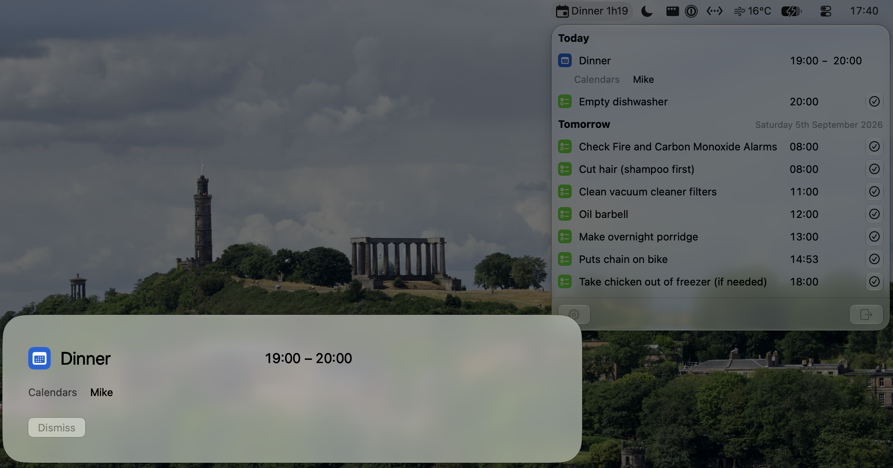

# 📅 MinMaxCal



MinMaxCal is a minimal calendar and reminder app (Min) that pulls you
out of flow and into meetings with a full-screen takeover and one-click
join (Max). Most of the time it shows only your next event or reminder
and a countdown in the menu bar, without a Dock icon.

## 💡 Motivation

I built MinMaxCal to replace a meeting reminder app and fix a few
annoying edge cases, such as combining identical events. It reads the
calendars and reminder lists already in macOS, so there's no separate
account. Optional calendar mirroring writes through those same accounts.

## ✨ Features

- See the next item and countdown in the menu bar. Browse today and
  tomorrow with merged meetings, calendar colours and expandable rows.
  Hide “Out of office” events. Matching titles merge if one time
  matches and the other differs by up to half the shorter duration.
  Use the most common times, or the full time range when tied.
- Take over every display at an event's start or a reminder's due time.
  Events need an accepted RSVP or none for you. Join with recording,
  complete reminders with five-minute Undo, dismiss or snooze.
- Mirror calendars for the coming month, copying titles, locations and
  links or using Busy or Travel titles. Preview with **Compare** before
  enabling **Sync**; originals are never changed.
- Optional [meeting coaching](COACHING.md): estimate your speaking
  share and transcribe meetings with on-device speech models on Mac.
- Use the [iPhone preview](#-iphone-preview) to browse your agenda, join
  calls and complete reminders with Undo, or the
  [Apple Watch preview](#-apple-watch-preview) for a read-only agenda.

## 🚫 Out of Scope

Anything EventKit's public APIs do not expose is either derived by a
documented rule or left out; private APIs are never used:

- **Accounts and servers.** macOS owns accounts and provider syncing;
  MinMaxCal only reads and writes their local EventKit data.
- **Automatic scheduling.** Create focus and habit events in Calendar;
  MinMaxCal can mirror them but never chooses or rearranges their times.
- **Multiple sync computers.** Run calendar mirroring on one Mac only.
- **Travel time and leave alerts.** EventKit does not expose travel
  time; the takeover is at the start, not before it.
- **Answering invitations.** Unanswered invitations show their status
  and are answered in Calendar, as before.
- **Snoozing in Reminders.** Snooze is the app's own and never edits
  the reminder.
- **An updater.** Releases contain no updater; Homebrew handles
  upgrades.

## 📋 Requirements

- An Apple silicon Mac running macOS Tahoe (26) or later.
- Full access to Calendars is required. Reminders access is requested
  on first launch but can be declined.
- Optional: the Zoom app, Microsoft Teams and Microsoft Edge for
  opening calls in them.

## 📦 Installation

Install and upgrade with Homebrew.

```bash
brew install minmaxcal
```

Alternatively, download `MinMaxCal-<version>.zip` from the
[releases page](https://github.com/MikeMcQuaid/MinMaxCal/releases),
unzip it and move `MinMaxCal.app` to /Applications. Releases are signed
with a Developer ID certificate and notarised by Apple.

To run from source, clone this repo and run from its root:

```bash
script/bootstrap
script/install
```

## ⚙️ Configuration

Settings opens from the agenda's footer or Cmd-, and controls:

- **Calendars**: selected calendars and reminder lists, grouped by
  account and shown in their colours.
- **Sync**: calendar pairs, copied content, all-day and Busy-only
  filters, comparison and automatic mirroring.
- **Takeover**: event and reminder triggers, the alert sound, snooze
  durations.
- **Join**: the preferred app for Zoom, Teams, Meet, Jitsi, FaceTime
  and other links, including Luma and Linux Foundation meeting links.
- **Matching**: generic titles to merge and home terms to omit from
  locations.
- **Coaching**: optional Mac-only recording, model downloads, speaking
  targets, transcripts and the Record when joining preference.
- **General**: launch at login, title length and permissions.

Direct downloads start at login by default; App Store builds require
opting in. Calendar mirroring is off until enabled in **Sync**.

## 🛠️ Development

- `script/bootstrap`: install dependencies and prepare version settings
- `script/build`: build in Release; set `XCODE_CONFIGURATION=Debug`
  for a debug build. Synchronised app folders discover new files.
- `script/install`: build, replace the /Applications copy and launch it
- `script/test`: unit tests
- `script/style [--fix]`: all linters, including README length limits
- `script/analyze`: static analysis and dead code

See [AGENTS.md](AGENTS.md) for the conventions and
[ARCHITECTURE.md](ARCHITECTURE.md) for behaviour details, the design,
[toolchain and CI](ARCHITECTURE.md#dependencies-and-toolchain) and
[releases](ARCHITECTURE.md#releases).

### TestFlight releases

Successful CI on `main` uploads private Mac, iPhone and Watch betas,
keeping the newest 20 per platform. Official releases add both builds to
the configured external group (**Public Beta** by default), request
beta review and publish the GitHub release; approval is asynchronous.
Both releases and public uploads are capped at three per 24 hours.
Install [TestFlight](https://apps.apple.com/app/testflight/id899247664)
and [join the public beta][testflight-beta] for available builds.
No App Store Connect account is needed. See [setup][testflight-setup]
and [beta copy](TESTFLIGHT.md). Dispatch **Release** from `main` with
a new bare version; dry runs never upload.

[testflight-beta]: https://testflight.apple.com/join/XhQqMckH
[testflight-setup]: ARCHITECTURE.md#set-up-testflight-releases

## 📱 iPhone preview

The iOS 26 companion shows today and tomorrow from the phone's system
calendars and reminder lists, with the Mac's merging and filtering.
Tap a row for details, join calls or complete reminders with Undo.
Events are read-only; undated reminders are omitted. Join uses the
system URL opener; takeovers and mirroring remain Mac-only.

Calendar and Reminders permissions are independent. All available
lists are included by default; choose individual lists and edit
matching rules in Settings. Preferences stay on the phone. The agenda
refreshes on launch, foregrounding, local changes and periodically;
system accounts handle cloud syncing.

To build from source instead, clone this repo and work from its root:

1. Install Xcode 27.2 with iOS support, run `script/bootstrap` and open
   `MinMaxCal.xcodeproj`. Choose **MinMaxCal-iOS** and your connected
   iPhone as the destination.
2. Choose your team under **Signing & Capabilities** with automatic
   signing enabled. A Personal Team works; use a unique bundle
   identifier if needed. The native JSON project is tracked in Git.
3. Enable **Developer Mode** on the phone, then press **Run** in Xcode.
   Add accounts in system settings and allow full Calendar and
   Reminders access when prompted.

See Apple's guides to [running on a device][run-on-device] and
[Developer Mode][developer-mode].

[run-on-device]: https://developer.apple.com/documentation/xcode/running-your-app-on-simulated-or-physical-devices
[developer-mode]: https://developer.apple.com/documentation/xcode/enabling-developer-mode-on-a-device

## ⌚ Apple Watch preview

The watchOS 26 app shows today and tomorrow from all local calendars
and reminder lists, using the shared merging and filtering rules.
Overdue reminders stay visible; undated reminders are omitted.
It is read-only, with no complications or settings sync. Calendar and
Reminders permissions are independent; system accounts supply its data.

To run it, install watchOS platform support in Xcode 27.2, run
`script/bootstrap` and select **MinMaxCal-watchOS** with your paired
Apple Watch as the destination. Choose your signing team for the
iPhone and watch targets, enable Developer Mode on the watch and run.
The watch app is included with the iPhone app and can run independently.

## 🚧 Status

Stable: all the features I care about are implemented and the app is
mostly in maintenance mode.

MinMaxCal is primarily for @MikeMcQuaid's personal use. I'll consider
other features and settings only if they do not make the app worse for
me.

## 📮 Contact

[Mike McQuaid](mailto:mike@mikemcquaid.com)

The [privacy policy](PRIVACY.md) explains local storage, calendar
mirroring and exported reports. Settings links to it and support on
both platforms.

## 📄 Licence

[AGPL-3.0](LICENSE) with an [App Store exception](LICENSE-EXCEPTION).
