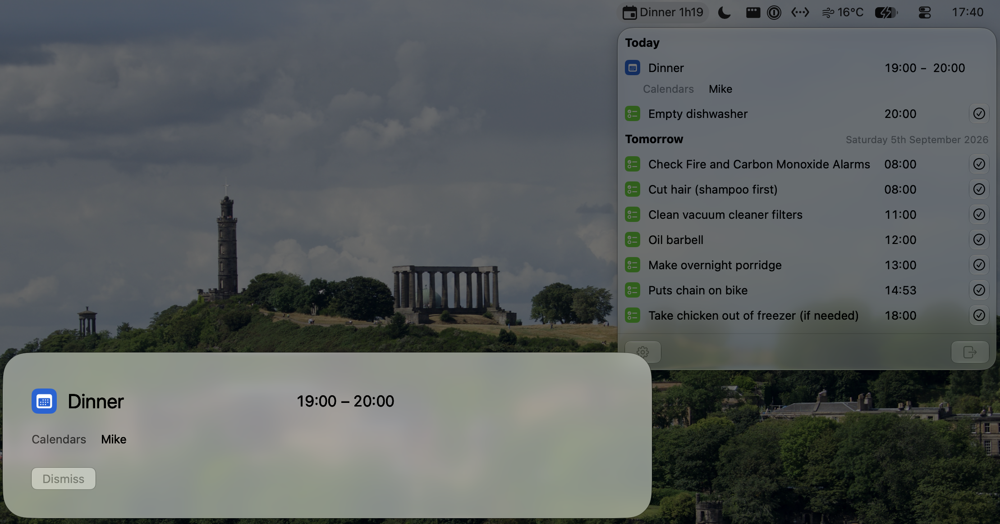

# 📅 MinMaxCal



MinMaxCal is a simple calendar and reminder app that lives in the menu
bar, not the Dock. Most of the time it shows only your next event or
reminder and a compact countdown. When that item is due, MinMaxCal takes
over every display with everything you need and one click to get where
you are going.

## 💡 Motivation

Calendar apps either hide in a window you forgot to look at or nag with
notifications you learnt to swipe away. MinMaxCal works at both
extremes: it is effortless to glance at and difficult to ignore when
something is due. It reads the calendars and reminder lists macOS
already has through EventKit, so it needs no separate account. Optional
calendar mirroring writes through those same macOS accounts.

## ✨ Features

- See the next item and countdown in the menu bar. Browse today and
  tomorrow with merged meetings, calendar colours and expandable rows.
- Take over every display when an accepted event starts or a reminder
  is due. Join calls, complete reminders with five-minute Undo, dismiss
  or snooze by mouse or keyboard.
- Mirror calendars for the coming month, copying titles, locations and
  links or using Busy or Travel titles. Preview with **Compare** before
  enabling **Sync**; originals are never changed.
- [iPhone preview](#-iphone-preview): browse your agenda and complete
  reminders with Undo.
- [Apple Watch preview](#-apple-watch-preview): read-only agenda on
  your wrist.

## 🚫 Out of Scope

Anything EventKit's public APIs do not expose is either derived by a
documented rule or left out; private APIs are never used:

- **Accounts and servers.** macOS owns accounts and provider syncing;
  MinMaxCal only reads and writes their local EventKit data.
- **Automatic scheduling.** Create focus and habit events in Calendar;
  MinMaxCal can mirror them but never chooses or rearranges their times.
- **Multiple sync computers.** Run calendar mirroring on one Mac only.
- **Travel time and leave alerts.** EventKit does not expose travel
  time; the takeover is at the start, not before it.
- **Answering invitations.** Unanswered invitations show their status
  and are answered in Calendar, as before.
- **Snoozing in Reminders.** Snooze is the app's own and never edits
  the reminder.
- **An updater.** Releases contain no updater; Homebrew handles
  upgrades.

## 📋 Requirements

- An Apple silicon Mac running macOS Tahoe (26) or later.
- Full access to Calendars is required. Reminders access is requested
  on first launch but can be declined.
- Optional: the Zoom app, Microsoft Teams and Microsoft Edge for
  opening calls in them.

## 📦 Installation

Install with Homebrew:

```bash
brew install --cask minmaxcal
```

`brew upgrade` updates the app.

Alternatively, download `MinMaxCal-<version>.zip` from the
[releases page](https://github.com/MikeMcQuaid/MinMaxCal/releases),
unzip it and move `MinMaxCal.app` to /Applications. Releases are signed
with a Developer ID certificate and notarised by Apple.

To run the current source instead:

```bash
script/bootstrap
script/install
```

## ⚙️ Configuration

Settings opens from the agenda's footer or Cmd-, and controls:

- **Calendars**: selected calendars and reminder lists, grouped by
  account and shown in their colours.
- **Sync**: calendar pairs, copied content, all-day and Busy-only
  filters, comparison and automatic mirroring.
- **Takeover**: event and reminder triggers, the alert sound, snooze
  durations.
- **Join**: the preferred app for Zoom, Teams, Meet, Jitsi, FaceTime
  and other links.
- **Matching**: generic titles to merge and home terms to omit from
  locations.
- **General**: launch at login, the menu bar title length and
  permissions.

Direct downloads start at login by default; App Store builds require
opting in. Calendar mirroring is off until enabled in **Sync**.

## 🛠️ Development

- `script/bootstrap`: install dependencies and generate the project
- `script/build`: build in Release; set `XCODE_CONFIGURATION=Debug`
  for a debug build
- `script/install`: build, replace the /Applications copy and launch it
- `script/test`: unit tests
- `script/style [--fix]`: all linters, including README length limits
- `script/analyze`: static analysis and dead code

See [AGENTS.md](AGENTS.md) for the conventions and
[ARCHITECTURE.md](ARCHITECTURE.md) for behaviour details, the design,
[toolchain and CI](ARCHITECTURE.md#dependencies-and-toolchain) and
[releases](ARCHITECTURE.md#releases).

### TestFlight releases

Releases upload the iPhone and bundled Watch app to TestFlight before
pushing the GitHub tag and publishing the Mac download.
Follow the [signing setup][testflight-setup], adding the shared
`APP_STORE_CERTIFICATES` and `APP_STORE_CERTIFICATES_PASSWORD` secrets,
plus `MINMAXCAL_APP_STORE_IOS_PROFILE` and
`MINMAXCAL_APP_STORE_WATCHOS_PROFILE`.
Release dry runs archive, sign, export and validate with Apple without
uploading a beta. After a successful dry run, dispatch **Release** from
`main` with a new bare version, then invite yourself in
App Store Connect.

[testflight-setup]: ARCHITECTURE.md#set-up-testflight-releases

## 📱 iPhone preview

The iOS 26 companion shows today and tomorrow from the phone's system
calendars and reminder lists, with the Mac's merging and filtering.
Tap a row for details or complete a reminder with five-minute Undo.
Events are read-only; undated reminders are omitted. Join buttons,
takeovers and calendar mirroring are Mac-only.

Calendar and Reminders permissions are independent. All available
lists are included by default; choose individual lists and edit
matching rules in Settings. Preferences stay on the phone. The agenda
refreshes on launch, foregrounding, local changes and periodically;
system accounts handle cloud syncing.

1. Install Xcode 27 with iOS support, run `script/bootstrap` and open
   `MinMaxCal.xcodeproj`. Choose **MinMaxCal-iOS** and your connected
   iPhone as the destination.
2. Choose your team under **Signing & Capabilities** with automatic
   signing enabled. A Personal Team works; use a unique bundle
   identifier if needed. XcodeGen may reset these local changes.
3. Enable **Developer Mode** on the phone, then press **Run** in Xcode.
   Add accounts in system settings and allow full Calendar and
   Reminders access when prompted.

See Apple's guides to [running on a device][run-on-device] and
[Developer Mode][developer-mode].

[run-on-device]: https://developer.apple.com/documentation/xcode/running-your-app-on-simulated-or-physical-devices
[developer-mode]: https://developer.apple.com/documentation/xcode/enabling-developer-mode-on-a-device

## ⌚ Apple Watch preview

The watchOS 26 app shows today and tomorrow from all local calendars
and reminder lists, using the shared merging and filtering rules.
Overdue reminders stay visible; undated reminders are omitted.
It is read-only, with no complications or settings sync. Calendar and
Reminders permissions are independent; system accounts supply its data.

To run it, install watchOS platform support in Xcode 27, run
`script/bootstrap` and select **MinMaxCal-watchOS** with your paired
Apple Watch as the destination. Choose your signing team for the
iPhone and watch targets, enable Developer Mode on the watch and run.
The watch app is included with the iPhone app and can run independently.

## 🚧 Status

Stable: all the features I care about are implemented and the app is
mostly in maintenance mode.

MinMaxCal is primarily for @MikeMcQuaid's personal use. I'll consider
other features and settings only if they do not make the app worse for
me.

## 📮 Contact

[Mike McQuaid](mailto:mike@mikemcquaid.com)

The [privacy policy](PRIVACY.md) explains local storage, calendar
mirroring and exported reports. Settings links to it and support on
both platforms.

## 📄 Licence

[AGPL-3.0](LICENSE) with an [App Store exception](LICENSE-EXCEPTION).
